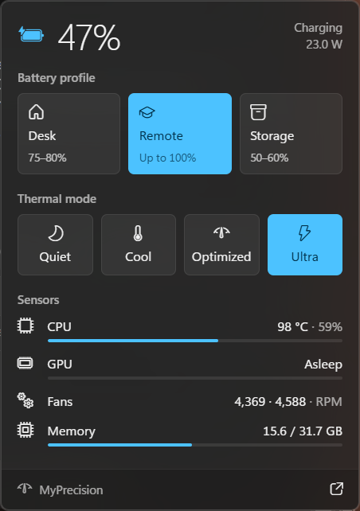
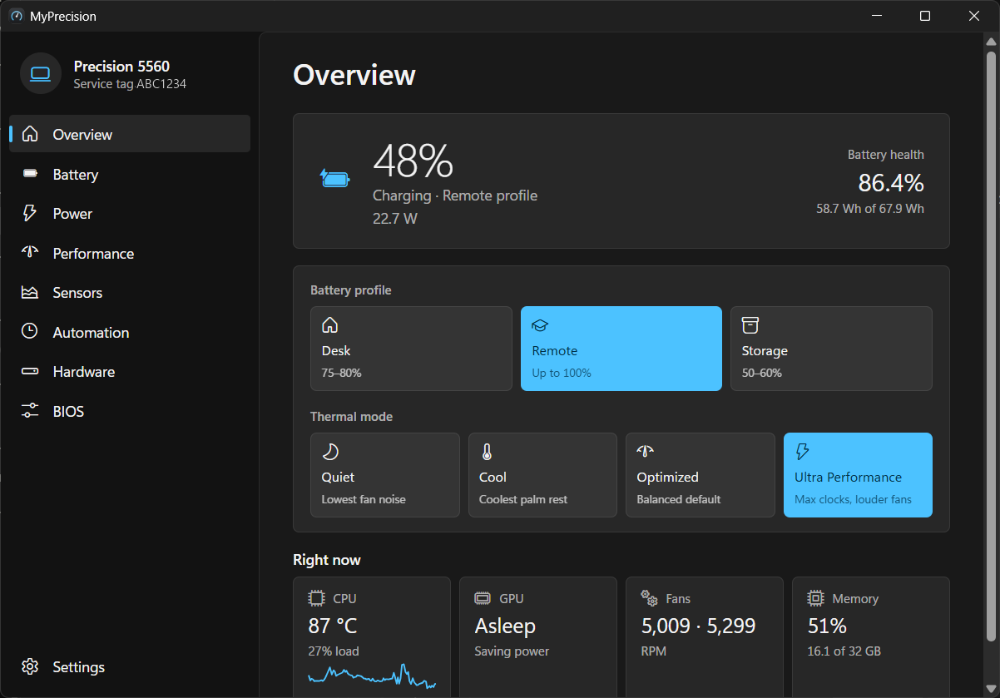
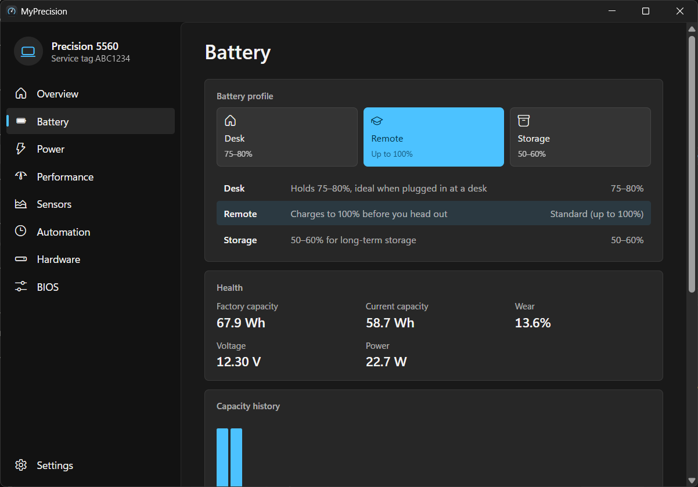
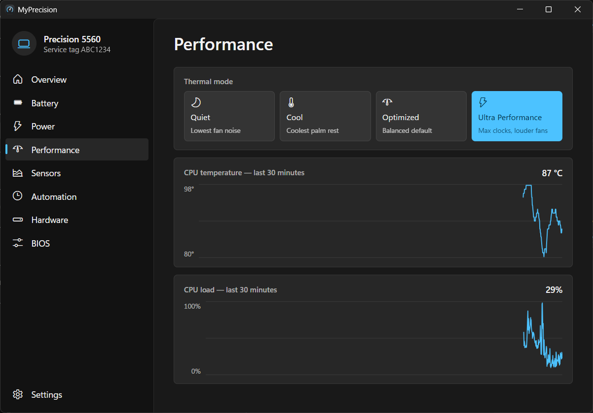

# MyStation

[](https://github.com/al3ksh/MyStation/actions/workflows/ci.yml)

A small, fast tray app for Dell business laptops. It does what Dell Optimizer
and SupportAssist do day to day: battery charge limits, thermal modes, health
and power stats. It has no background bloat and no telemetry, and the UI
follows Windows 11.

The app takes the name of the laptop it runs on: **MyPrecision** on a
Precision, **MyXPS** on an XPS, **MyLatitude** on a Latitude, and
**MyStation** on anything else.

Built with [Tauri 2](https://tauri.app), Rust and Svelte 5. Developed and
tested on a Precision 5560 (Intel + NVIDIA T1200).

## Features

<p align="center">
  
</p>

**Tray flyout.** Click the tray icon to see charge, power draw and CPU
temperature. From there you can switch the battery profile or thermal mode in
one click. The flyout uses Acrylic blur, and the tray icon shows the charge
level live.

**Battery profiles**

| Profile | Charge range | For |
|---------|--------------|-----|
| Desk    | 75–80%       | Plugged in most of the day |
| Remote  | up to 100%   | Before you head out |
| Storage | 50–60%       | Laptop sitting unused for a while |

**Thermal modes:** Optimized, Cool, Quiet and Ultra Performance.

**Full window**

<p align="center">
  
  
  
</p>

- **Overview:** what the machine is doing right now.
- **Battery:**
  - Health, plus factory and current capacity.
  - Capacity history.
  - Charge and power charts.
- **Performance:** thermal modes and CPU load and clock charts.
- **Sensors:** temperatures and fan speeds.
- **Hardware:**
  - Drive health.
  - Startup apps and what slowed the last boot.
  - USB devices with the battery draw each one adds.
- **Power:**
  - Integrated vs. NVIDIA graphics.
  - A per-app graphics choice (Auto / Integrated / NVIDIA).
  - Battery use by app.
  - Sleep drain.
- **Automation:**
  - Thermal mode by power source.
  - A battery profile schedule.
  - Battery protection when the laptop stays plugged in for a long time.
- **BIOS settings:** read and change supported BIOS options.
- **Settings:** autostart and updates.

**Updates.** The app updates itself from GitHub Releases. Updates are signed
and install in the background.

## Requirements

- Windows 11 (Windows 10 may work but is untested).
- A Dell laptop supported by Dell Command | Configure: Precision, Latitude
  and most XPS models.
- [Dell Command | Configure](https://www.dell.com/support/kbdoc/en-us/000178000/dell-command-configure).
  It is required for battery profiles, thermal modes and BIOS settings.
- [Dell Command | Monitor](https://www.dell.com/support/kbdoc/en-us/000177080/dell-command-monitor)
  (optional). It adds fan speeds and extra temperature sensors.
- An NVIDIA driver (optional). It adds GPU stats.

MyStation runs with administrator rights, because changing BIOS charge and
thermal settings needs them. Autostart registers a scheduled task, so you
don't get a UAC prompt on every boot.

## Install

Download the latest `MyStation_x.y.z_x64-setup.exe` from
[Releases](https://github.com/al3ksh/MyStation/releases/latest) and run it.
Later versions are offered in the app under **Settings → Updates**.

Up to 0.4.0 the app was called MyPrecision. Updating from it installs
MyStation alongside, then on first start MyStation moves the sign-in task over
and silently removes the old install. Your settings and history are kept.

## Build from source

You need [Node.js](https://nodejs.org) 20+, [Rust](https://rustup.rs) (stable,
edition 2024) and the
[Tauri prerequisites for Windows](https://tauri.app/start/prerequisites/).

```bash
npm install
npm run tauri dev
```

To build an installer:

```bash
npm run tauri build
```

### Tests

```bash
npm test
npm run check
cargo test --workspace --lib
cargo clippy --workspace --lib --all-targets -- -D warnings
```

## Project layout

```
crates/core/   platform-independent logic: battery, profiles, BIOS, sensors, history
src-tauri/     the Tauri app: commands, tray, poller, automation, Windows APIs
src/           Svelte UI: flyout, full window pages, components, tests
scripts/       release script (signed installer + updater manifest)
```

## Releasing

1. Bump the version in `package.json`, `src-tauri/tauri.conf.json` and both
   `Cargo.toml` files.
2. Rename the `Unreleased` section of [CHANGELOG.md](CHANGELOG.md) to the
   new version and commit it to master.
3. Run `npm run release`.

The script builds the signed installer, tags the current master commit and
publishes a GitHub Release. The release carries the `latest.json` manifest the
updater reads, and its notes come from the changelog. It refuses to run when
the tree is dirty, when master is not level with origin, or when the version
has no changelog section. Add `--dry-run` to build without publishing.

The updater signing key stays on the maintainer's machine and is never
committed.

## Disclaimer

MyStation is an independent project. It is not affiliated with, endorsed by
or supported by Dell Technologies. Dell, Precision, Latitude, XPS, Dell
Command | Configure and Dell Command | Monitor are trademarks of Dell Inc. The app changes BIOS
settings through Dell's own tools, and you use it at your own risk.

## License

[MIT](LICENSE) © 2026 Aleks Szotek
